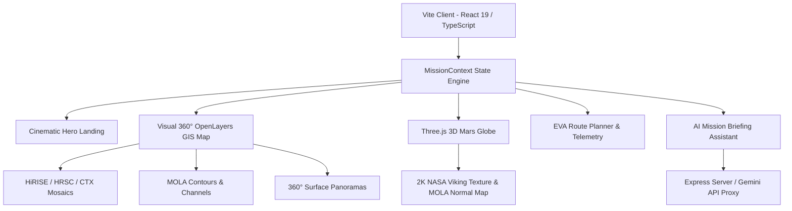

# Mars X Mission

Mars X Mission is an interactive Martian map built to give every astronaut an easy, safe path to explore Mars. It combines real orbital imagery, terrain and elevation data, a 3D Mars globe, and 360° surface views, so crews can plan routes across Mars, avoid obstacles and hazards, and prepare for human exploration with confidence.

[](https://react.dev/)
[](https://www.typescriptlang.org/)
[](https://threejs.org/)
[](https://openlayers.org/)
[](https://tailwindcss.com/)
[](LICENSE)

An interactive mission-control workstation and planetary geospatial intelligence platform engineered for Mars surface exploration. **MARS X MISSION** provides astronaut EVA route planning, high-resolution orbital imagery analysis, 3D planetary observation, MOLA topographic relief, and AI-assisted mission briefings for mars exploration and making it easy.

---

## 🚀 Key Capabilities

### 1. 🪐 3D Planetary Observation
- **Interactive Three.js WebGL Mars Globe**: High-fidelity 3D sphere with authentic 2K NASA Viking true-color albedo and MOLA (Mars Orbiter Laser Altimeter) normal relief.
- **Dual Telemetry Modes**:
  - `Normal Mars`: Natural surface albedo with topographic relief of Olympus Mons, Valles Marineris, and Hellas Planitia.
  - `Thermal Mars`: Calibrated surface thermal inertia visualization showing diurnal temperature retention.
- **Accurate Planetary Physics**: Built-in 25.19° axial obliquity and dynamic solar terminator lighting.

### 2. 🗺️ Visual 360° Panoramic Map (Jezero Crater)
- **High-Resolution Multi-Layer Orbital GIS** (powered by OpenLayers 10):
  - **HiRISE Delta Mosaic**: Ultra-high-resolution 0.25 m/pixel mosaic covering the western delta fan deposits.
  - **HRSC Mars Express True Color**: Multispectral color mosaic from ESA's Mars Express orbiter.
  - **CTX Global Mosaic**: Context camera mosaic at 6 m/pixel resolution.
  - **MOLA Elevation Contours**: Vector elevation contour overlay labeled with calibrated depths (e.g. -2500m, -2400m, -2300m).
  - **Neretva Vallis Inflow Channels**: Precise mapping of the ancient river inflow breach.
- **True 360° Spherical Panoramas**: Clickable surface viewpoints that open full equirectangular panoramic projections captured by NASA's Perseverance rover Mastcam-Z.
- **Clustered Viewpoint Navigation**: Dynamic spatial clustering of rover viewpoints with smooth zoom transitions.

### 3. 🛰️ Astronaut EVA Traverse Engineering
- **Jezero Reference Route**: 9 verified waypoints traversing from *Octavia E. Butler Landing* across the western delta scarp (*Hawksbill Gap*), past *Three Forks*, ascending through *Neretva Vallis* to *Lookout Hill*.
- **IAU 2000 Mars Spheroid Geodesy**: Accurate planetary distance calculations using the IAU 2000 Mars reference ellipsoid ($R = 3389.5\text{ km}$).
- **Segment-by-Segment Telemetry**:
  - Total cumulative distance, one-way distance, estimated traversal duration.
  - Net elevation differential ($\Delta z$) and cumulative vertical ascent.
- **Interactive MOLA Route Elevation Profile**: Dynamic SVG elevation cross-section chart with real-time waypoint hover markers and slope gradient telemetry.

### 4. 🧠 AI Mission Assistant & Briefing Compiler
- **Server-Side Gemini Integration**: Automated generation of mission safety briefings, geological anomaly assessments, and hazard warnings.
- **Deterministic Scientific Compiler**: Ingests real-time atmospheric dust optical depth ($\tau$), surface pressure (710 Pa), and radiation dosimetry to output actionable operational guidance.

### 5. 🌡️ Environmental & Radiation Telemetry
- **Diurnal Surface Temperature Modeling**: Tracks diurnal thermal swings from $-88^\circ\text{C}$ nocturnal lows to $-15^\circ\text{C}$ afternoon peaks.
- **Atmospheric Pressure & Density**: Real-time barometric tracking across varying crater elevations.
- **Radiation Dosimetry**: Galactic Cosmic Ray (GCR) and Solar Particle Event (SPE) tissue-equivalent dose monitoring.

---

## 🏗️ Architecture & Tech Stack



### Frontend
- **Framework**: React 19, TypeScript
- **Styling**: Tailwind CSS 4, Custom Glassmorphism & Cybernetic UI
- **3D Graphics**: Three.js (WebGL, PBR materials, OrbitControls)
- **Mapping & GIS**: OpenLayers 10 (Custom IAU 2000 Mars projection)
- **Icons**: Lucide React

### Backend & Tooling
- **Server**: Node.js, Express, TypeScript (`tsx`)
- **Build System**: Vite 8, Rollup/Rolldown
- **Geospatial Utilities**: Custom Mars ellipsoid geodesy algorithms
- **Image Preprocessing**: Python OpenCV (CLAHE, unsharp masking, inpainting)

---

## 📁 Repository Structure

```
MARSX/
├── public/
│   ├── assets/
│   │   └── jezero/             # HiRISE, HRSC, DTM, contour & channel tiles
│   ├── models/                 # 3D Mars GLB models (Normal & Thermal)
│   ├── panoramas/              # 360° equirectangular rover panoramas
│   ├── hero-pristine-hd.jpg    # 2K high-definition hero background
│   └── mars_viking_color_2k.jpg# NASA Viking true-color 2K map
├── src/
│   ├── components/
│   │   ├── common/             # ErrorBoundary, GlassPanel, StatCards
│   │   ├── dashboard/          # MissionOverview, Workstation view
│   │   ├── landing/            # CinematicHeroLanding, RotatingMarsSphere
│   │   ├── layout/             # TopNavigation, Sidebar, Panels
│   │   ├── map/                # VisualMap360 (OpenLayers), MarsGlobe3D (Three.js)
│   │   ├── route/              # RoutePlanner, ElevationProfile, Telemetry
│   │   ├── terrain/            # TerrainIntelligence, GeomorphicUnits
│   │   └── ai/                 # MarsAIPanel, MissionBriefing
│   ├── context/                # MissionContext (Global exploration state)
│   ├── data/                   # MarsMissionData, JezeroWaypoints, Regions
│   ├── types/                  # Mission, Geospatial, and Telemetry TypeScript interfaces
│   └── utils/                  # marsGeospatial (IAU 2000 geodesy, elevation)
├── server.ts                   # Express application & Gemini API bridge
├── vite.config.ts              # Vite configuration
├── package.json                # Project dependencies and scripts
└── README.md                   # Project documentation
```

---

## 🛠️ Getting Started

### Prerequisites
- **Node.js**: v18.0.0 or higher
- **npm** or **bun**

### Installation

1. **Clone the repository**:
   ```bash
   git clone https://github.com/jeevandj2008s-byte/MARSX.git
   cd MARSX
   ```

2. **Install dependencies**:
   ```bash
   npm install
   ```

3. **Configure Environment Variables**:
   Copy the example environment template:
   ```bash
   cp .env.example .env
   ```
   *(Optional)* Add your Gemini API key in `.env` if you wish to use live AI assistant generation:
   ```env
   GEMINI_API_KEY="your-gemini-api-key-here"
   APP_URL="http://localhost:3000"
   ```

### Running Locally

- **Development server** (Starts frontend Vite dev server with Express backend):
  ```bash
  npm run dev
  ```
  Open [http://localhost:3000](http://localhost:3000) in your browser.

- **Typecheck & Linting**:
  ```bash
  npm run lint
  ```

- **Production Build**:
  ```bash
  npm run build
  ```

- **Preview Production Build**:
  ```bash
  npm run preview
  ```

---

## 🔒 Security & Privacy

This project strictly adheres to security best practices:
- No API keys, credentials, or private authentication tokens are stored in source code.
- `.env` and local secrets are excluded via `.gitignore`.
- All client-side requests to external AI APIs route through server-side environment variable injection.

---

## 📄 License

This project is licensed under the MIT License — see the [LICENSE](LICENSE) file for details.
