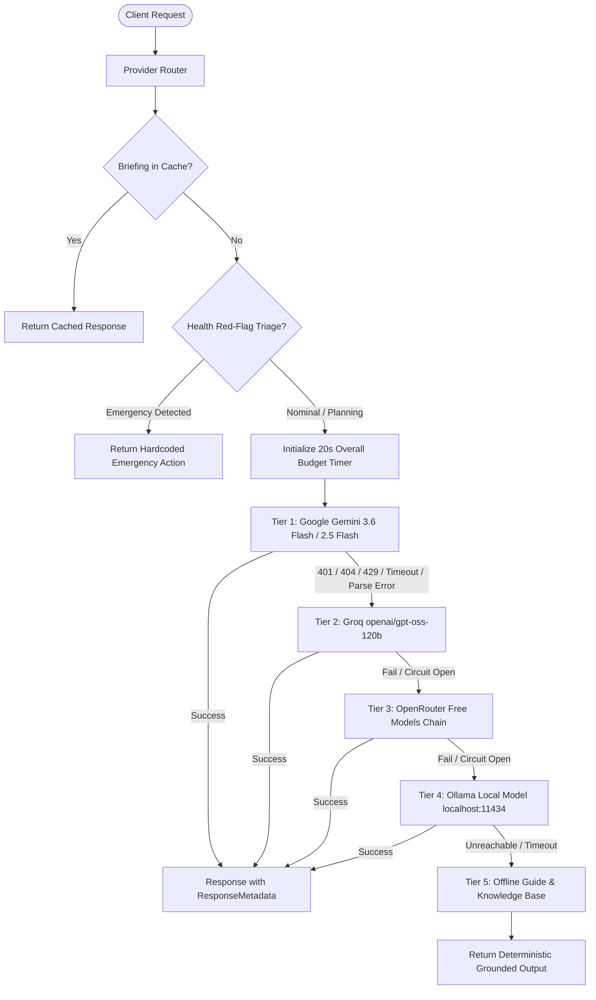

# ROVERSE AI Resilience & Multi-Provider Fallback Architecture

**Project:** ROVERSE - Mars Surface Exploration Planning System  
**Challenge:** NASA Space Apps Challenge 2026 - *Interplanetary Survival Guide: Martian Map*  
**Region:** Gale Crater / Mount Sharp  
**Mission Scenario:** Boxwork Discovery Expedition (Educational Simulation)  

---

## 1. Resilience Philosophy: Zero-Crash & Strict Grounding

In critical mission operations and live hackathon demonstrations, the AI integration must **never crash** and every endpoint must always return schema-valid JSON. 

ROVERSE achieves 100% uptime through a **multi-tier provider chain** with automatic circuit breaking, deadline budgeting, and a 100% deterministic local offline guide tier backed by curated Gale Crater planetary science.

### Core Operational Rules:
1. **Numbers Strictly from Data**: Distances, durations, slopes, elevations, and radiation levels come strictly from telemetry and NASA mission layers (MOLA, HiRISE, THEMIS, CRISM, MSL RAD). The AI never calculates or hallucinates numbers.
2. **Missing Layers**: Missing or unobserved data is explicitly cited as `"data not available"`.
3. **No 500 AI Errors**: Network drops, rate limits (HTTP 429), authentication rejections (HTTP 401/403), or provider outages gracefully fall through the chain to the next provider, and finally to the offline guide.
4. **Deterministic Red-Flag Health Triage**: Immediate EVA emergency symptoms (chest pain, acute dyspnea, suit pressure drops, critical radiation alerts) bypass all external LLMs and return hardcoded NASA-aligned emergency safety protocols.
5. **Educational Simulation**: All outputs carry explicit notices that ROVERSE is a prototype simulation and not certified NASA flight software.

---

## 2. Fallback Chain Architecture



### Circuit Breaker Specifications:
- **3 Consecutive Failures**: Provider circuit enters `open` state and is skipped for 60 seconds (`CIRCUIT_BREAKER_RESET_SECONDS`).
- **HTTP 401/403 (Auth Failure)**: Provider circuit is set to `disabled` for the entire session (preventing spamming invalid keys).
- **HTTP 404 (Model Not Found)**: Model is removed from candidate list; provider tries fallback model.
- **HTTP 429 (Rate Limit)**: Honors `Retry-After` if short (<5s), otherwise trips circuit breaker and moves to next provider.
- **Per-Call Timeout**: 15 seconds (`REQUEST_TIMEOUT_SECONDS`).
- **Overall Request Budget**: 20 seconds (`OVERALL_REQUEST_BUDGET_SECONDS`). If remaining budget drops below 1.0s, the router skips remote calls directly to the instant offline provider.

---

## 3. Environment Variables Reference

Configure providers in `.env` (server-side only, never exposed to browser):

| Variable | Default Value | Description |
| :--- | :--- | :--- |
| `AI_PROVIDER_ORDER` | `gemini,groq,openrouter,ollama,offline` | Comma-separated list defining priority order. |
| `GEMINI_API_KEY` | `""` | Google Gemini API key. |
| `GEMINI_MODEL` | `gemini-3.6-flash` | Primary Gemini model. |
| `GEMINI_FALLBACK_MODEL` | `gemini-2.5-flash` | Fallback model if primary model is unavailable. |
| `GROQ_API_KEY` | `""` | Groq API key (OpenAI-compatible). |
| `GROQ_BASE_URL` | `https://api.groq.com/openai/v1` | Groq endpoint. |
| `GROQ_MODEL` | `openai/gpt-oss-120b` | Primary Groq model. |
| `GROQ_MODEL_2` | `openai/gpt-oss-20b` | Secondary Groq model. |
| `OPENROUTER_API_KEY` | `""` | OpenRouter API key. |
| `OPENROUTER_BASE_URL`| `https://openrouter.ai/api/v1` | OpenRouter endpoint. |
| `OPENROUTER_MODELS` | `openai/gpt-oss-120b:free,google/gemma-4-31b-it:free,...` | Ordered comma-separated list of OpenRouter models. |
| `MISTRAL_API_KEY` | `""` | Optional Mistral API key. |
| `MISTRAL_MODEL` | `mistral-small-latest` | Mistral model identifier. |
| `OLLAMA_BASE_URL` | `http://localhost:11434` | Local Ollama base URL. |
| `OLLAMA_MODEL` | `gemma4` | Local Ollama model. |
| `REQUEST_TIMEOUT_SECONDS` | `15.0` | Timeout per provider attempt. |
| `OVERALL_REQUEST_BUDGET_SECONDS` | `20.0` | Hard deadline for entire fallback chain per request. |
| `CIRCUIT_BREAKER_FAILURES` | `3` | Failure threshold to open circuit. |
| `CIRCUIT_BREAKER_RESET_SECONDS` | `60.0` | Cooldown period before half-open retry. |
| `DEMO_MODE` | `false` | When true, forces offline guide mode for zero-latency presentations. |

---

## 4. How to Obtain Free API Keys

All cloud providers in the chain offer free-tier access:

1. **Google Gemini (Tier 1)**:
   - URL: [https://aistudio.google.com/apikey](https://aistudio.google.com/apikey)
   - Generous free requests per minute for `gemini-3.6-flash` and `gemini-2.5-flash`.
2. **Groq (Tier 2)**:
   - URL: [https://console.groq.com/keys](https://console.groq.com/keys)
   - Ultra-fast free inference on open-weights models (`openai/gpt-oss-120b`, `llama-3.3-70b-versatile`).
3. **OpenRouter (Tier 3)**:
   - URL: [https://openrouter.ai/keys](https://openrouter.ai/keys)
   - Aggregates free models ending with `:free` (Gemma 4, Nemotron, GPT-OSS).
4. **Mistral (Tier 4, Optional)**:
   - URL: [https://console.mistral.ai](https://console.mistral.ai)
   - Free tier keys for `mistral-small-latest`.

---

## 5. Local Offline Setup (Ollama)

For air-gapped or offline demonstrations:
```bash
# 1. Install Ollama from https://ollama.com
# 2. Pull a recommended model:
ollama pull gemma4
# or
ollama pull llama3.2

# 3. Verify server is listening at http://localhost:11434
curl http://localhost:11434/api/tags
```
Set in `.env`:
```env
OLLAMA_BASE_URL=http://localhost:11434
OLLAMA_MODEL=gemma4
```

---

## 6. How to Test Failover & Circuit Breaking

### 1. Run Provider Diagnostics
```bash
python scripts/check_providers.py
```
Outputs validation table without leaking API keys.

### 2. Simulate Gemini Outage
Temporarily change your `GEMINI_API_KEY` in `.env` to `invalid_key_test`.
Run a mission briefing or smoke test:
```bash
python backend/smoke_test.py
```
- Gemini returns HTTP 401/403.
- Circuit breaker marks Gemini `disabled` for the session.
- Request immediately falls through to Groq (`openai/gpt-oss-120b`).
- Response succeeds with:
  ```json
  "response_metadata": {
    "provider_used": "groq",
    "model_used": "openai/gpt-oss-120b",
    "degraded": true,
    "fallback_reason": "Served by fallback provider 'groq'",
    "latency_ms": 612
  }
  ```

### 3. Simulate Total Network Cutoff
Turn off Wi-Fi or set `DEMO_MODE=true` in `.env`:
- App continues serving all endpoints instantly using `OfflineProvider`.
- All schemas remain 100% valid.

---

## 7. System Diagnostics API (`GET /api/ai/status`)

Clients and frontend UI check real-time provider resilience at `GET /api/ai/status`:
```json
{
  "status": "operational",
  "project": "ROVERSE - Mars Surface Exploration Planning System",
  "active_provider_order": ["gemini", "groq", "openrouter", "ollama", "offline"],
  "providers": {
    "gemini": {
      "name": "gemini",
      "configured": true,
      "healthy": true,
      "circuit_state": "closed",
      "configured_models": ["gemini-3.6-flash", "gemini-2.5-flash"],
      "verified_models": ["gemini-3.6-flash"]
    },
    "groq": {
      "name": "groq",
      "configured": true,
      "healthy": true,
      "circuit_state": "closed",
      "configured_models": ["openai/gpt-oss-120b", "openai/gpt-oss-20b"],
      "verified_models": ["openai/gpt-oss-120b", "openai/gpt-oss-20b"]
    },
    "offline": {
      "name": "offline",
      "configured": true,
      "healthy": true,
      "circuit_state": "closed",
      "configured_models": ["offline-templates"],
      "verified_models": ["offline-templates"]
    }
  },
  "demo_mode": false,
  "circuit_breakers_active": []
}
```
*Zero secrets, tokens, or keys are returned.*
